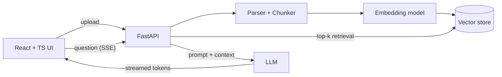

<div align="center">

# 📚 DocuMind AI

**Chat with your documents — a production-style Retrieval-Augmented Generation (RAG) app.**

Upload PDFs, notes or policies and get grounded answers with numbered citations, streamed token-by-token.


**[▶ Live demo](https://hanzalasqb.github.io/documind-ai/)** · runs in your browser with sample documents

</div>

---

## 🌐 Live demo mode

The [live demo](https://hanzalasqb.github.io/documind-ai/) is the same React app built with `VITE_DEMO=true` and deployed to GitHub Pages by GitHub Actions. It preloads three sample documents and runs a browser-only RAG pipeline: a TypeScript port of the backend chunker, **BM25** retrieval in place of embeddings, and extractive answers with `[n]` citations in place of the LLM, streamed token by token. You can upload your own `.txt` / `.md` files; they stay in the browser tab. Run it locally with `npm run dev:demo` in `frontend/`.

## ✨ Features

- **Document ingestion** — PDF, TXT and Markdown upload with size/type validation
- **Smart chunking** — overlapping chunks that break on paragraph and sentence boundaries
- **Semantic search** — embeddings + cosine similarity with per-document filtering
- **Grounded answers** — the LLM answers only from retrieved context and cites sources as `[1]`, `[2]`
- **Real-time streaming** — Server-Sent Events (sources first, then tokens)
- **Provider-agnostic** — works with any OpenAI-compatible API: OpenAI, Groq, Together or a local **Ollama** model
- **Conversation memory** — recent chat history is sent for follow-up questions
- **Production setup** — Docker Compose, Nginx reverse proxy, typed config, pytest suite, GitHub Actions CI

## 🏗️ Architecture



| Layer | Tech |
|-------|------|
| Frontend | React 18, TypeScript, Vite, react-markdown |
| Backend | FastAPI, Pydantic v2, httpx (async) |
| AI | OpenAI-compatible chat + embedding APIs (OpenAI / Ollama / Groq) |
| Retrieval | NumPy cosine-similarity vector store (swappable for pgvector / Qdrant) |
| DevOps | Docker, Docker Compose, Nginx, GitHub Actions |

## 📁 Project structure

```
documind-ai/
├── backend/
│   ├── app/
│   │   ├── main.py              # API routes (upload, list, delete, chat, SSE stream)
│   │   ├── config.py            # typed settings from env
│   │   ├── schemas.py           # request/response models
│   │   └── services/
│   │       ├── parser.py        # PDF / text extraction
│   │       ├── chunker.py       # boundary-aware chunking
│   │       ├── llm.py           # OpenAI-compatible provider (chat, stream, embed)
│   │       ├── vector_store.py  # persistent vector index
│   │       └── rag.py           # retrieval + prompt assembly
│   └── tests/                   # pytest suite with offline fake LLM
├── frontend/                    # React + Vite client
├── docker-compose.yml
└── .github/workflows/ci.yml
```

## 🚀 Getting started

### Option 1 — Docker

```bash
git clone https://github.com/hanzalasqb/documind-ai.git
cd documind-ai
cp backend/.env.example backend/.env   # add your API key
docker compose up --build
```

Open **http://localhost:3000** (API docs at http://localhost:8000/docs).

### Option 2 — Local development

```bash
# backend
cd backend
python -m venv .venv && source .venv/bin/activate
pip install -r requirements.txt
cp .env.example .env
uvicorn app.main:app --reload

# frontend (new terminal)
cd frontend
npm install
npm run dev      # http://localhost:5173
```

### Run fully local with Ollama (no API key)

```env
LLM_BASE_URL=http://localhost:11434/v1
LLM_API_KEY=ollama
CHAT_MODEL=llama3.1
EMBEDDING_MODEL=nomic-embed-text
```

## 🔌 API

| Method | Endpoint | Description |
|--------|----------|-------------|
| `POST` | `/api/documents` | Upload and index a document |
| `GET` | `/api/documents` | List indexed documents |
| `DELETE` | `/api/documents/{id}` | Remove a document and its vectors |
| `POST` | `/api/chat` | Ask a question (JSON response with sources) |
| `POST` | `/api/chat/stream` | Ask a question (Server-Sent Events) |

## 🧪 Tests

```bash
cd backend && pytest -q
```

Tests use a deterministic fake embedding model, so they run offline and in CI without API keys.

## 🗺️ Roadmap

- [ ] pgvector backend for multi-tenant deployments
- [ ] Hybrid search (BM25 + vectors) and re-ranking
- [ ] JWT auth and per-user document spaces
- [ ] OCR for scanned PDFs

## 👤 Author

**Hanzala Saqib** — Full Stack AI Developer
[GitHub](https://github.com/hanzalasqb)

## 📄 License

MIT
